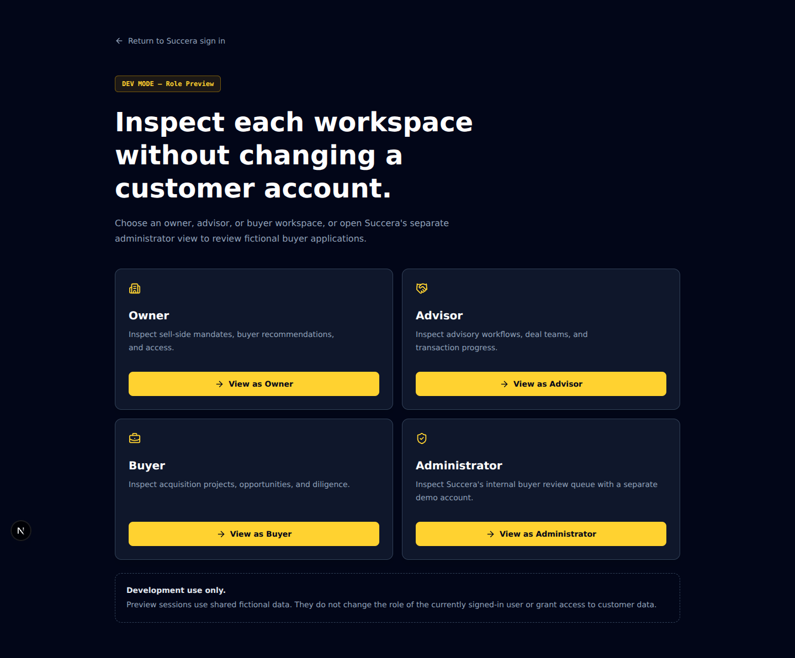

# Succera developer demo

Prepared for the October 23, 2026 presentation. Use the development preview with
fictional data. The production site intentionally does not offer role switching.

## Start the presentation environment

Use Node.js 24.14 or later within Node 24. After checking out
`codex/succera-demo-2026-10-23`, install its locked dependencies and start a local
instance:

```sh
npm ci
APP_ENV=development APP_URL=http://localhost:3000 DATABASE_URL=pglite:presentation DATA_DIR=./data/presentation-2026-10-23 PRIVATE_FILE_STORAGE=filesystem ALLOW_DEMO=true COOKIE_SECURE=false npm run dev -- --port 3000
```

Open `http://localhost:3000/dev/preview`. The explicit local database and file
settings keep this demonstration separate from hosted customer records. A new
data directory creates a fresh fictional dataset without deleting old data.

If the app was already running before the update, stop and restart that server.
Database initialization repairs the earlier Advisor demo's administrator flag
and creates the separate Administrator demo account.

The selector has four entries:



| Preview       | Identity                                   | Main purpose                                         |
| ------------- | ------------------------------------------ | ---------------------------------------------------- |
| Owner         | Jamie Chen                                 | Seller mandate, buyer selection, confidential access |
| Advisor       | Alex Morgan                                | Client mandates and deal coordination                |
| Buyer         | Taylor Reid / Evergreen Capital            | Acquisition criteria, invitations, diligence         |
| Administrator | Succera Administrator / Succera Operations | Internal buyer profile reviews                       |

Use **Switch demo role** in one tab. A role switch replaces the shared browser
session; two tabs in the same browser profile are not independent users. For a
side-by-side demonstration, use separate browser profiles.

## Recommended 8–10 minute walkthrough

1. **Public homepage — 45 seconds.** Explain the focus: established Canadian
   businesses with approximately C$1M–C$20M annual revenue, private introductions,
   and an organized transaction workspace.
2. **Owner → Project Cedar — 2 minutes.** Open `/app/deals/cedar`. Show the mandate,
   historical financials, the sharing checklist, and the visible distribution
   strategy. Explain that creating a mandate does not broadcast the business.
3. **Buyers tab — 2 minutes.** Show recommended acquisition projects and their
   match explanations. Explain selective teaser outreach, buyer responses, and
   seller approval. An introduction does not by itself disclose the company or
   unlock documents.
4. **Buyer → Project Cedar — 2 minutes.** Switch through the developer selector.
   Cedar has prepared fictional buyer access. Show the deal room, documents,
   conversation, and diligence tasks. Seller-only notes and files remain hidden.
5. **Advisor — 1 minute.** Show the mandate overview and coordination workflow.
   This preview no longer includes platform-admin links.
6. **Administrator — 1 minute.** Open the separate Administrator preview, then
   Buyer reviews. Choose **All** or **Approved** to inspect the two prepared
   fictional applications; the initial Pending queue can be empty because those
   buyers are already approved. Use **Back to workspace → Switch demo role** to
   leave administration.

Keep the main story on an existing prepared mandate. Use the new-mandate exercise
below if the professor wants to see how seller information reaches a buyer.

## Demonstrate a newly created mandate reaching a buyer

As **Owner**, create a private mandate with fictional details. This example fits
the seeded Evergreen buyer's business-services criteria:

| Field                      | Example                                                                                         |
| -------------------------- | ----------------------------------------------------------------------------------------------- |
| Company name, confidential | Presentation Services Ltd.                                                                      |
| Project name               | Project Maple Demo                                                                              |
| Industry / province        | Business services / Ontario                                                                     |
| Annual revenue             | C$8,000,000                                                                                     |
| EBITDA                     | C$1,400,000                                                                                     |
| Indicative asking price    | C$10,000,000                                                                                    |
| Transaction type           | Majority acquisition                                                                            |
| Financial year             | 2025                                                                                            |
| Business description       | An established maintenance business with recurring contracts and an experienced operating team. |

Open **Add project name and optional deal details** to complete the project and
financial fields. Create the mandate, then:

1. In **Manage this mandate**, leave **Distribution strategy → Private outreach**.
2. Select **Review buyers and share teaser** to open the Buyers tab.
3. Select Evergreen Capital's **Project Northern Lights** recommendation, choose
   **Select chosen (1)**, then explicitly click **Share teaser**.
4. Switch to **Buyer** and open **Opportunities** (`/app/opportunities`). The new
   mandate appears as a **Private invitation**. Open it to show the anonymized
   teaser. Company identity and confidential documents remain gated.

Saving a mandate or its settings does not send outreach. If you choose
**Qualified Discovery**, explicitly check **Publish in Qualified Discovery** and
save. Discovery additionally requires a qualifying active buyer project and the
configured firm-verification threshold; it is not visible to every buyer.

Changing a mandate back to private outreach stops discovery publication. Existing
invitations and approved access are managed separately in Buyers.

## Present capabilities accurately

- The sample companies, financials, documents, and applications are fictional.
  Seeded documents are illustrative text samples, not executed contracts.
- Buyer review records identity and self-reported capital context. It does not
  establish independent proof of funds or guarantee buyer quality.
- NDA execution is external in the focused pilot. The seller reviews the uploaded
  NDA before granting confidential access.
- Electronic signatures, external AI teaser review, the public directory, public
  transaction publishing, and email delivery are deferred pilot capabilities.
- The app supports coordination and access controls; legal agreements, funding,
  diligence conclusions, and transaction closing happen outside it.

## Before the meeting

- Start the server and open each intended view once to warm development compilation.
- Confirm the four role-preview choices and a clean Advisor navigation.
- Open Project Cedar and confirm its prepared document list loads.
- Keep one presentation browser tab and use Switch demo role deliberately.
- Prepare the Administrator queue's All/Approved filter before showing it.

Useful feedback questions: Which step would save you the most time? What evidence
would make you trust a buyer? What would an owner need to see before sharing a
confidential business through this process?

## Verification evidence

The demo-readiness change adds explicit administrator-isolation and seed-repair
regressions, production demo denial for all preview types, and a browser test
that creates a mandate through the UI, proves it is initially private, shares it
with one selected buyer, and checks that the teaser appears without confidential
identity or document access.

Run `npm run typecheck`, `npm test`, `npm run build`, and `npm run test:e2e` before
release. Tests use isolated local data. See the pull request for the final run
results and any execution-environment limitations.
